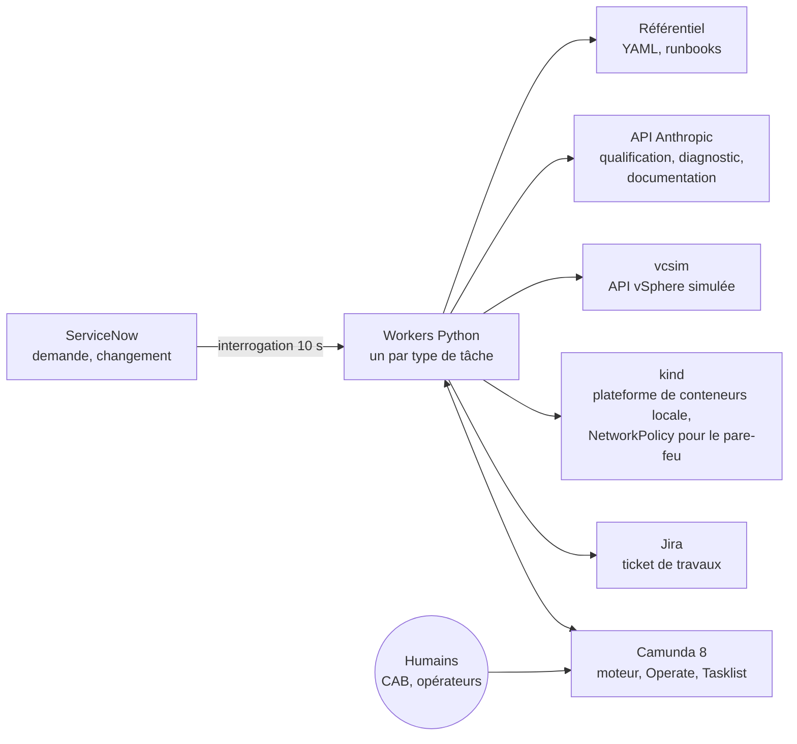
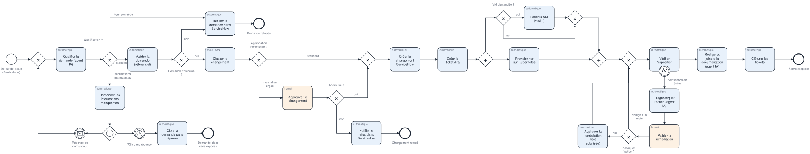
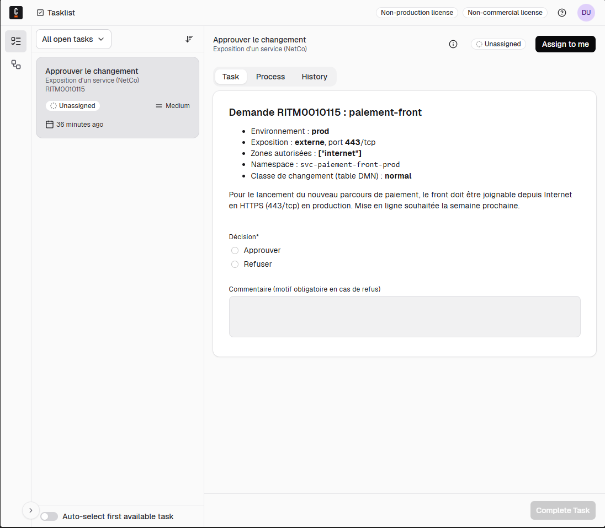
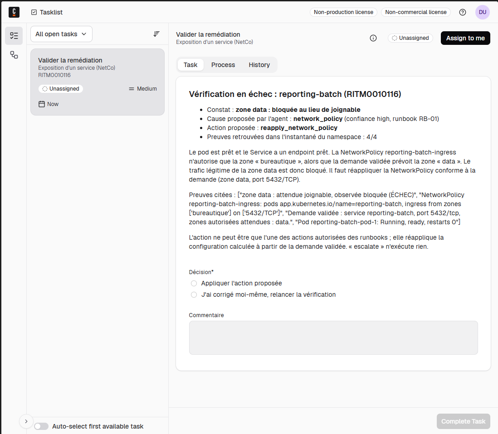
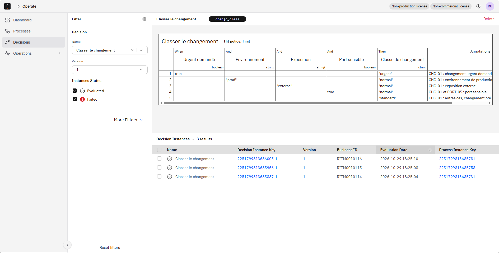
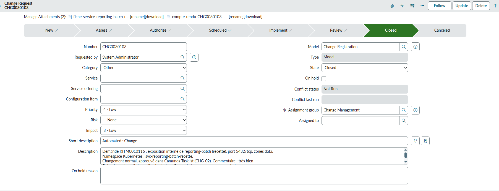
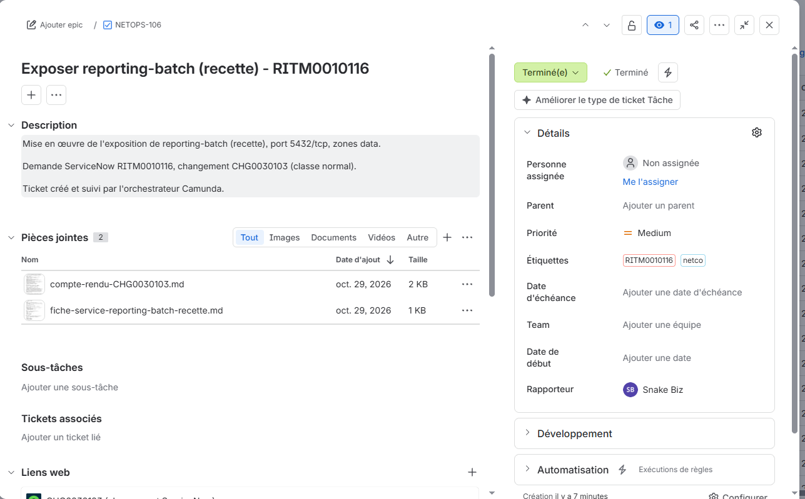
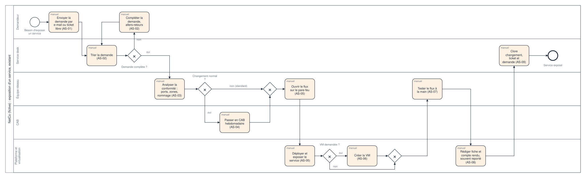

<!-- Généré par `make readme` depuis docs/README.template.md et results/*.json. Ne pas modifier à la main. -->
# infra-request-orchestrator

> **Entreprise et données fictives.** NetCo est une entreprise inventée pour ce projet. Toutes les demandes,
> tous les tickets et toutes les configurations de ce dépôt sont synthétiques. Aucun client réel, aucune donnée
> réelle.

Orchestration de bout en bout d'une demande d'infrastructure, « exposer un service sur le réseau » :
- la demande part de ServiceNow ;
- Camunda 8 l'orchestre ;
- le travail se fait dans Jira, sur un cluster Kubernetes local (kind) et sur un simulateur de l'API vSphere
  (vcsim).

Des agents IA proposent, un processus BPMN et une table DMN décident, et un humain valide toute action
corrective.

## Architecture





Les étapes du processus :
1. **Qualification.** Un agent IA transforme le texte libre en formulaire, en citant le référentiel, et pose
   une question au demandeur s'il manque une information.
2. **Conformité et classement.** Le référentiel vérifie la conformité, puis une table DMN classe le changement.
3. **Approbation.** Le CAB approuve les changements normaux dans Tasklist.
4. **Tickets.** Un changement ServiceNow et un ticket Jira sont créés.
5. **Provisionnement.** Le service est déployé sur kind et, si la demande en réclame une, une VM est créée sur
   vcsim en parallèle.
6. **Vérification.** Une sonde est lancée depuis chaque zone réseau. Si elle échoue, un agent de diagnostic en
   lecture seule propose une action d'une liste fermée ; un opérateur la valide avant toute exécution.
7. **Documentation et clôture.** Un agent rédige la fiche de service et le compte rendu du changement, contrôlés
   automatiquement, puis joints aux deux tickets avant la clôture.

## Captures


*Tasklist : l'approbation du CAB, avec la classe calculée par la table DMN*


*Tasklist : la remédiation proposée par l'agent (cause, preuves, runbook), à valider*


*Operate : la table DMN qui classe le changement, et ses évaluations*


*ServiceNow : le changement clos, avec la fiche de service et le compte rendu joints*


*Jira : le ticket de travaux terminé, avec les deux documents joints*

## Résultats

Chaque chiffre de cette page est recopié depuis `results/` par `make readme`. La CI régénère la page et échoue
au moindre écart.

### Agents, sur des cas figés
| Agent | Mesure | Résultat |
|---|---|---|
| Qualification (30 cas) | Demandes entièrement justes | 27/27 (Wilson 95 % : 0,875 à 1) |
| | Informations manquantes repérées | 8/8 (Wilson 95 % : 0,676 à 1) |
| | Fausses alertes sur un manque | 0/19 (Wilson 95 % : 0 à 0,168) |
| | Demandes hors périmètre repérées | 3/3 (Wilson 95 % : 0,439 à 1) |
| | Décision finale juste (après référentiel et DMN) | 30/30 (Wilson 95 % : 0,886 à 1) |
| | Citations retrouvées dans le référentiel | 71/71 (Wilson 95 % : 0,949 à 1) |
| | Coût par demande | 0,00813 $ |
| Diagnostic (10 pannes injectées) | Bonne cause | 10/10 (Wilson 95 % : 0,723 à 1) |
| | Bonne action | 10/10 (Wilson 95 % : 0,723 à 1) |
| | Preuves citées présentes dans l'instantané | 35/35 (Wilson 95 % : 0,901 à 1) |
| | Coût par diagnostic | 0,01029 $ |

Sources : [results/qualification.json](results/qualification.json) et
[results/diagnosis.json](results/diagnosis.json). Les cas sont synthétiques et écrits par l'auteur : un score
plein sur un petit échantillon n'est pas une garantie (voir l'intervalle de Wilson).

### Processus, mesuré en laboratoire
Échantillon : 5 exécutions de l'e2e, appels LLM en mode live, soit 20 demandes :
- 5 standard ;
- 5 normales avec VM ;
- 5 en texte libre ;
- 5 avec une panne réseau.

Tout tourne sur un seul poste, et les décisions humaines sont simulées par le script. Source :
[results/metrics.json](results/metrics.json), produit par `make metrics` depuis l'historique Camunda.

| Mesure | Valeur |
|---|---|
| Demandes terminées | 20/20 (Wilson 95 % : 0,839 à 1) |
| Durée de bout en bout, médiane | 33,7 s (de 25,1 s à 80,9 s) |
| Médiane : standard, normale avec VM, texte libre, panne | 26,0 s, 29,2 s, 46,1 s, 76,5 s |
| Temps de traitement hors attente humaine simulée, médiane | 30,1 s |
| Latence médiane : qualification, diagnostic, documentation | 5,8 s, 6,3 s, 10,3 s |
| Activités automatisées | 210/225 |
| Demandes sans aucune intervention humaine (les standard) | 5/20 (Wilson 95 % : 0,112 à 0,469) |
| Coût LLM par demande, médiane (maximum) | 0,0255 $ (0,0387 $) |
| Documentation rédigée par l'agent et acceptée par le contrôle | 20/20 (Wilson 95 % : 0,839 à 1) |

### Hypothèse « as-is » (non mesurée)
| Demande | Étapes manuelles | Effort humain | Délai |
|---|---|---|---|
| Standard, sans VM | 7 | 185 min | 3 à 12 jours ouvrés |
| Normale, avec VM | 9 | 240 min | 4 à 20 jours ouvrés |

Ces valeurs sont des hypothèses de l'auteur ([hypotheses/as-is.yaml](hypotheses/as-is.yaml)) pour une entreprise
fictive, pas une mesure. Les deux tableaux ne se soustraient pas : le laboratoire ne mesure pas l'attente humaine
réelle (CAB, demandeur), qui fait l'essentiel du délai supposé. Aucun gain n'est donc affirmé. La première
mesure à faire sur le terrain est un relevé de tickets réels ([diagnostic](docs/01-diagnostic-as-is.md)).

## Livrables de conseil

Six documents courts (2 pages au plus chacun) dans [docs/](docs/) :

| Document | Contenu |
|---|---|
| [01 Diagnostic de l'existant](docs/01-diagnostic-as-is.md) | Cartographie BPMN, irritants, priorisation de 8 processus |
| [02 Architecture cible](docs/02-architecture-cible.md) | Processus cible, composants, intégration, Camunda, n8n ou scripts, agents |
| [03 Feuille de route](docs/03-feuille-de-route.md) | Pitch de 5 minutes, trois vagues, indicateurs de sortie |
| [04 Gouvernance](docs/04-gouvernance.md) | Rôles, cycle de vie du modèle, indicateurs, garde-fous IA |
| [05 Guide opérationnel](docs/05-guide-operationnel.md) | Démarrer, suivre, traiter un incident, valider une remédiation |
| [06 Kit de formation](docs/06-kit-formation.md) | Atelier de 2 h avec trois exercices et leurs corrigés |



Les diagrammes sont produits par `make diagrams` depuis les modèles BPMN. Le suivi phase par phase est dans
[docs/PROGRESS.md](docs/PROGRESS.md).

## Démarrer en local

Prérequis : Docker avec Compose 2.24 ou plus, [uv](https://docs.astral.sh/uv/), GNU make,
[kind](https://kind.sigs.k8s.io/), et un fichier `.env` rempli (modèle : [.env.example](.env.example)).

```sh
make setup                    # environnement Python 3.12 (uv)
make lint test                # ruff et pytest
make up kind-up deploy-bpmn   # Camunda 8.10 et vcsim, cluster kind avec les zones réseau, modèles déployés
make verify                   # accès aux API ServiceNow et Jira, en lecture seule
make seed                     # 5 demandes NetCo dans ServiceNow
make workers                  # workers et interrogation de ServiceNow (laisser tourner, Ctrl+C pour arrêter)
```

Ce que deviennent les 5 demandes dans Operate :
- **`catalogue-api`** : standard, elle est traitée sans intervention humaine.
- **`paiement-front` et `reporting-batch`** : normales, elles attendent l'approbation dans Tasklist (groupe
  `cab`). `reporting-batch` crée en plus une VM dans vcsim.
- **`facturation-api`** : il manque l'environnement. L'agent pose la question en commentaire sur la demande
  ServiceNow, et la réponse du demandeur, en commentaire, relance l'instance.
- **`legacy-erp`** : elle est refusée par le référentiel (PORT-01, port RDP interdit), avec un commentaire dans
  ServiceNow.

Pour voir le diagnostic, il faut injecter une panne avant `make workers`, par exemple en PowerShell :
`$env:NETCO_INJECT_FAULT = "network_policy_zone:reporting-batch"`. Les variantes sont listées dans
[src/k8s/faults.py](src/k8s/faults.py). Le script de démonstration de 5 minutes est dans
[docs/DEMO.md](docs/DEMO.md).

Les autres commandes :

```sh
make e2e       # le scénario complet, approbations et réponses simulées par le script
make eval      # les évaluations des agents, rejouées depuis cassettes/llm/ : sans clé, sans coût
make metrics   # les mesures des exécutions e2e en mode live, depuis l'historique Camunda
make readme    # cette page, depuis docs/README.template.md et results/
make kind-down down
```

| Service | Adresse | Accès |
|---|---|---|
| Operate | http://localhost:8080/operate | `demo` / `demo` |
| Tasklist | http://localhost:8080/tasklist | `demo` / `demo` |
| API REST Camunda | http://localhost:8080/v2 | sans authentification (configuration locale légère) |
| Connectors | http://localhost:8086 | |
| vcsim, simulateur de l'API vSphere | https://localhost:8989/sdk | n'importe quel identifiant |

La pile reprend la configuration Docker Compose « légère » officielle de Camunda 8.10, que l'éditeur destine au
développement local et à l'évaluation. Les écarts sont décrits en tête de [docker-compose.yml](docker-compose.yml).

## Ce que ce projet ne montre pas

- **Une infrastructure d'entreprise.**
  - Kubernetes tourne sur kind, l'équivalent local d'une plateforme de conteneurs.
  - La virtualisation est simulée par vcsim : les VM existent dans l'API, mais n'exécutent rien.
  - Le pare-feu est modélisé par des NetworkPolicy.
- **Une tenue en charge ou une haute disponibilité.** Tout tourne sur un poste, avec Camunda en configuration
  légère, sans authentification sur ses API.
- **De vrais demandeurs, un vrai CAB, de vrais opérateurs.** Dans les mesures, leurs décisions sont simulées en
  quelques secondes par le script.
- **Un gain de temps.** L'existant est une hypothèse, pas une mesure. Aucun gain n'est affirmé.
- **Des agents éprouvés sur de vraies demandes.** Les cas d'évaluation sont synthétiques, écrits par l'auteur,
  et les pannes sont injectées une à la fois.
- **Une sécurité de niveau entreprise.** ServiceNow est appelé avec le compte admin en authentification Basic,
  sur une instance développeur personnelle.
- **Le cycle de vie complet d'un service.** Le décommissionnement n'est pas traité.

## Limites

Le détail est dans [docs/LIMITS.md](docs/LIMITS.md). Les idées hors périmètre sont dans
[docs/NEXT.md](docs/NEXT.md).

Auteur : Seifeddine BEN RHOUMA.
